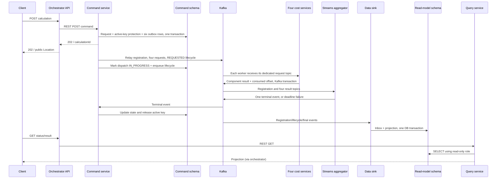

# Event-driven cost calculation

An executable Java 21 learning implementation of REST orchestration, CQRS, a transactional outbox, Kafka workers, Kafka Streams aggregation, and PostgreSQL projections. All nine services have implementations. Demo pricing is intentionally simple; production deployment hardening is listed under limitations.

## Quick start

Requires Java 21, Maven 3.6.3+, Python 3 for smoke tests, and Docker Desktop/Engine with Compose v2 running. Run commands from this repository.

```sh
mvn clean install
docker compose --profile apps up --build -d
docker compose --profile apps ps
curl http://localhost:8080/actuator/health
python3 scripts/smoke-test.py
```

The first build downloads dependencies. Wait for service startup before running the smoke test. Compose creates Kafka topics, PostgreSQL roles/schemas, and starts all applications. Command and sink services apply their own Flyway migrations. Workers, Streams and database consumers may take additional time to join groups on a cold start. If a first request times out during startup, use a new calculationId after the services have joined.

**Existing scaffold PostgreSQL volume:** Docker init scripts execute only when the database volume is first initialized. If you previously ran the scaffold, bootstrap roles without deleting data:

```sh
docker compose up -d postgres
docker compose exec -T postgres psql -v ON_ERROR_STOP=1 -U cost -d cost_calculation < infra/postgres-init.sql
docker compose --profile apps up --build -d
```

`docker compose down` stops services and retains data. Use `docker compose --profile apps down` to explicitly include applications. `docker compose down -v` permanently removes local database and Kafka data; use only for an intentional reset. After source edits, rebuild JARs with Maven before rebuilding Docker images: the Dockerfile packages the already-built module JAR.

### Run services from an IDE

```sh
docker compose up -d
mvn clean install
mvn -pl command-service spring-boot:run
# In separate terminals, run the remaining eight modules the same way.
```

Each module has a `*Application` main class. Use `DEMO_FAILURES=true` for workers to enable the failure products in the examples; Compose enables this for the learning environment. Do not run duplicate IDE and Compose instances unintentionally: consumers with the same group share partitions.

Host JVMs use `localhost:9092`; application containers use `kafka:29092`. PostgreSQL listens on `localhost:5432` for host JVMs. Docker exposes host ports on loopback only.

## Try the APIs

```sh
curl -i -X POST http://localhost:8080/api/calculations \
  -H 'Content-Type: application/json' \
  -d '{"calculationId":"11111111-1111-4111-8111-111111111111","rp":"RP1","mp":"MP1","vbu":"VBU1","financeGroup":"FG1","productId":"P100","quantity":10}'

curl http://localhost:8080/api/calculations/11111111-1111-4111-8111-111111111111
```

POST returns 202 with the accepted ID/state and a public `Location` header. A normalized identical replay returns 200 with `replay:true`. A reused ID with a changed payload or an already-active business key returns 409. Invalid inputs return 400. GET returns 200 when the projection exists; 404 means unknown or not yet projected. Orchestrator connection failures return 503; retry commands with the original ID.

A completed projection has this shape (metadata abbreviated):

```json
{
  "calculationId": "11111111-1111-4111-8111-111111111111",
  "state": "COMPLETED",
  "request": {"productId":"P100","quantity":10},
  "result": {
    "state":"COMPLETED",
    "components":{"FIRST_COST":1000.00,"FREIGHT_COST":125.00,"HANDLING_COST":50.00,"INVENTORY_COST":25.00},
    "totalCost":1200.00,
    "currency":"INR",
    "finishedAt":"2026-10-13T00:00:00Z"
  },
  "updatedAt":"2026-10-13 00:00:00+00"
}
```

Actual `request` contains the complete normalized request. Money uses Java BigDecimal and JSON decimal numbers, never Java floating-point arithmetic. On failure, `result` contains state, error, currency, empty components, and finishedAt; `totalCost` is absent. A failure does not expose a partial sum.

### Pricing and controlled failures

Each service multiplies a configured unit rate by quantity:

| Component | Default unit rate | Demo failure productId |
|---|---:|---|
| FIRST_COST | 100.00 | FAIL_FIRST_COST |
| FREIGHT_COST | 12.50 | FAIL_FREIGHT_COST |
| HANDLING_COST | 5.00 | FAIL_HANDLING_COST |
| INVENTORY_COST | 2.50 | FAIL_INVENTORY_COST |

`COST_UNIT_RATE` is configured separately per worker. Rates must be nonnegative with at most two decimal places. `DEMO_FAILURES` defaults to false outside Compose. Currency defaults to INR and is set centrally by command-service using `CALCULATION_CURRENCY`. Quantity must be a whole integer from 1 through 1,000,000; business-key fields and productId are nonblank, at most 100 characters. Business-key normalization trims surrounding whitespace and preserves case.

For a failure, submit a new ID and business key with productId `FAIL_FREIGHT_COST`. The freight service publishes a business failure; the aggregator fails without waiting for the other three services.

For a missing-result test, with the application stack running:

```sh
docker compose --profile apps stop inventory-cost-service
python3 scripts/smoke-test.py --expect-timeout
# Always restore the worker afterward:
docker compose --profile apps start inventory-cost-service
```

The default deadline is 60 seconds from acceptance. Change `CALCULATION_DEADLINE_SECONDS` on command-service to alter it. On restart, the worker may produce a late result; terminal aggregation state prevents it from changing FAILED.

## Modules and ownership

| Module | Responsibility | Port |
|---|---|---:|
| contracts | Immutable event/request records, enums, JSON codec, event validation | — |
| orchestrator-api | Public REST facade; calls command-service for POST and query-service for GET | 8080 |
| command-service | Request validation, write model, active-key uniqueness, outbox relay, terminal-event consumption | 8081 |
| query-service | Read-only GET APIs over projected state | 8082 |
| first-cost-service | FIRST_COST request consumer and result producer | 8083 |
| freight-cost-service | FREIGHT_COST request consumer and result producer | 8084 |
| handling-cost-service | HANDLING_COST request consumer and result producer | 8085 |
| inventory-cost-service | INVENTORY_COST request consumer and result producer | 8086 |
| calculation-aggregator | Kafka Streams state store, correlation, terminal decisions and wall-clock deadlines | 8087 |
| data-sink-service | Idempotently persists registration, lifecycle and final projections | 8088 |

The root POM manages Java and shared versions. Each service is its own executable Boot JAR. `contracts` is a regular library. `infra/` holds PostgreSQL bootstrap and topic provisioning; `scripts/` holds verification commands. Each database-owning service has its own Flyway migrations.

Pinned learning baseline: Spring Boot 3.5.6, Kafka broker 3.9.1, PostgreSQL 17.6. Spring Boot manages Spring Kafka, Kafka Streams/client, JUnit 5 and Testcontainers versions. These pins are reproducible versions, not a claim that they are the latest patched releases.

## End-to-end sequence



`REQUESTED` means durably accepted. `IN_PROGRESS` means outbox dispatch completed, not that every worker has started. Normal flow is `REQUESTED → IN_PROGRESS → COMPLETED | FAILED`. A final event may overtake lifecycle delivery, so projection updates can go directly to terminal state. Terminal state is never downgraded.

## Kafka topics

All business records use UTF-8 calculationId as key, JSON as value, and three partitions locally. No worker shares another worker's consumer group. Replicas of the same service share a group. Command and sink consume final events independently.

| Topic | Producer | Consumer |
|---|---|---|
| cost.calculation.requested.v1 | command outbox | aggregator and data sink |
| cost.first.requested.v1 | command outbox | first-cost-service |
| cost.freight.requested.v1 | command outbox | freight-cost-service |
| cost.handling.requested.v1 | command outbox | handling-cost-service |
| cost.inventory.requested.v1 | command outbox | inventory-cost-service |
| cost.first.result.v1 | first-cost-service | aggregator |
| cost.freight.result.v1 | freight-cost-service | aggregator |
| cost.handling.result.v1 | handling-cost-service | aggregator |
| cost.inventory.result.v1 | inventory-cost-service | aggregator |
| cost.calculation.lifecycle.v1 | command outbox | data sink |
| cost.calculation.final.v1 | aggregator | command and data sink |
| `<source-topic>.dlt` | consumer error recovery | manual inspection/recovery |
| cost.calculation.aggregation.dlt | aggregator | manual inspection/recovery |

Provisioning is explicit in `infra/create-topics.sh`; broker auto-creation is disabled. Streams creates its own changelog topic under application ID `cost-calculation-aggregator-v1`. The deployment identity of Streams is stable. Worker transaction IDs include a process-unique prefix to prevent fencing between replicas.

### Partitioning and correlation

The aggregator merges registration and all four result topics into a stateful processor. Identical calculationId keys must use the same serializer, partitioner and partition count across those topics. This places all component results in the same Streams task. Do not independently increase partition counts: use a coordinated repartition/application migration.

Kafka ordering exists within a topic partition only. The relay sends registration first, but a result can still be processed before registration from another topic. The aggregator buffers early results, then decides once registration arrives. This prevents losing early results and supplies the fixed deadline/currency needed for validation. A failure is emitted immediately once the calculation is registered, without waiting for other component results.

## Event schemas

`Events.java` is the source of truth for version 1 records. All events use this envelope:

```json
{"eventId":"22222222-2222-4222-8222-222222222222","eventType":"CalculationRequestedEvent","schemaVersion":1,"occurredAt":"2026-10-13T00:00:00Z","calculationId":"11111111-1111-4111-8111-111111111111","payload":{}}
```

The Kafka key must equal calculationId. UUIDs and times use strings. Unknown optional JSON fields are tolerated; unsupported schema versions/types are rejected. Event IDs are retained across outbox retries. Worker result IDs are deterministically derived from the request event ID plus component; terminal IDs from calculationId.

| eventType | payload |
|---|---|
| CalculationRequestedEvent | request (all seven client fields), currency, deadlineAt |
| CalculationLifecycleEvent | state=REQUESTED or IN_PROGRESS, stateVersion=1 or 2 |
| CostComponentResultEvent | componentType, success boolean, currency; amount on success or error on failure |
| CalculationCompletedEvent | state=COMPLETED, all four component amounts, totalCost, currency, finishedAt |
| CalculationFailedEvent | state=FAILED, empty components, currency, error, finishedAt; no totalCost |

`error` has `code`, safe `message`, and `retryable`. Retryable timeout errors still terminate the current calculation; a client retry uses a new ID after release. Component business failures are final, while transport exceptions use bounded Kafka recovery.

The aggregator validates a result's component against its source topic. It rejects malformed amounts, wrong currency, key mismatches, and conflicting success amounts. A failure supersedes a prior success while the calculation is active. Once terminal, later events cannot change the outcome. Final consumers validate the type/state pairing and completion sum before persisting.

## Reliability, CQRS and consistency

**CQRS:** command-service owns authoritative writes; data sink owns projection writes; query-service only reads. One PostgreSQL instance hosts separate `command` and `read_model` schemas. Roles are `command_app`, `sink_app`, and `query_app`; the query role has SELECT privileges and default read-only transactions. There is no query write API and no direct command read from the projection. This is CQRS with current-state persistence, not event sourcing.

**Active business keys:** a PostgreSQL partial unique index on `(rp, mp, vbu, finance_group)` applies to REQUESTED/IN_PROGRESS. Unique calculationId separately protects replay identity. The DB constraint decides concurrent races, not a check-then-insert. Commands normalize and persist the complete immutable request. A repeated ID with changed quantity/product/business fields conflicts. productId and quantity are intentionally not part of the active business key. A terminal command update removes the row from the partial index; old duplicate final events cannot release another calculation's reservation.

**Outbox:** the accepted request and six outgoing records commit together. A scheduled relay publishes registration, four component requests and lifecycle events, then marks delivery. A PostgreSQL advisory lock serializes relay batches across replicas. If Kafka is unavailable, rows stay pending. A crash after publication but before commit can duplicate messages. Dispatch state is updated conditionally, so it cannot downgrade a completed calculation. The relay trades throughput for understandable local transaction boundaries; it is not a high-volume CDC implementation.

**Workers:** Spring Kafka transactions atomically publish a result and commit the request offset. Transient processing/publish exceptions retry twice with a one-second backoff, then recover to the request DLT in a new transaction; malformed input is non-retryable. A missing result subsequently fails by deadline. Producer idempotence and deterministic result IDs tolerate transport duplicates. Rate configuration must stay stable during processing/replay; a production implementation should snapshot a pricing version/rate or persist immutable worker outcomes.

**Streams:** a persistent RocksDB store tracks registration, results by component, first-seen time, and terminal status. `exactly_once_v2` commits state/changelog/offsets/output together. Four distinct successes produce a sum; duplicate successes cannot count as extra components. Any failure before completion terminates without a sum. A wall-clock punctuator checks stored deadlines every second, even when there is no new traffic. After downtime, overdue calculations fail when processing resumes. Orphan results without registration are quarantined after five minutes. Terminal markers are retained, protecting against late results/replays within this application state.

**Database delivery:** inbox deduplication and state updates are one local DB transaction. Kafka offset acknowledgment occurs after the listener returns. Redelivery after a database commit is harmless. Database outages retry indefinitely; invalid events are sent to a DLT only after successful DLT publication. A final event for an unknown command retries conservatively and requires investigation.

**Projection ordering:** registration can fill missing request metadata after a final event. Lifecycle versions prevent stale updates; terminal projection always dominates them. Conflicting final outcomes are quarantined. Streams' Kafka exactly-once guarantee does not extend to PostgreSQL or external HTTP calls.

**Eventual consistency:** delays exist from acceptance to Kafka, Kafka to results, final decision to command release, and all events to the read model. You may see 404 immediately after 202, stale IN_PROGRESS, or a final projection before the key is reusable. These are deliberate asynchronous boundaries, not grounds to resubmit with a different ID before checking the original.

## Configuration

Common overrides: `SERVER_PORT`, `KAFKA_BOOTSTRAP_SERVERS`, `DB_URL`, `DB_USERNAME`, `DB_PASSWORD`. Orchestrator uses `COMMAND_URL` and `QUERY_URL`. Aggregator uses `KAFKA_STREAMS_STATE_DIR`. Workers use `COST_UNIT_RATE`, `DEMO_FAILURES`, and optionally a replica-unique `INSTANCE_ID` for Kafka transaction IDs.

Local database passwords are `command_app_local`, `sink_app_local`, and `query_app_local`; bootstrap administrator is `cost` / `cost_local_only`. These are development credentials. Changing them requires changing both bootstrap roles and application settings; PostgreSQL volumes retain initialized credentials.

## Tests and verification

```sh
mvn clean verify
# Require Docker rather than accepting skipped container tests:
sh scripts/verify-integration.sh
# With the full Compose stack already running:
python3 scripts/smoke-test.py
```

JUnit tests cover REST delegation/status preservation, deterministic worker redelivery and failures, and Streams duplicate handling, immediate failure, result-before-registration, malformed/null events, and wall-clock expiration. Testcontainers tests use real PostgreSQL for idempotency, concurrent active keys, terminal release and projection ordering; a real Kafka container verifies transactional worker consumption/publication with read_committed consumers.

Container tests are explicitly skipped if Docker is unavailable. A green build with skipped tests does not establish integration success. The smoke script checks the full HTTP → Kafka → Streams → database → query path, including total, replay, conflict, key reuse and business failure. Its timeout mode checks a missing worker. See `VERIFICATION.md` for the checks actually run in this workspace.

## Failure scenarios and operational limits

| Scenario | Implemented response |
|---|---|
| Client loses response | Same ID/payload returns existing command |
| Concurrent active key | DB unique index permits one; loser gets 409 |
| PostgreSQL acceptance error | Request/outbox transaction rolls back; no 202 |
| Kafka unavailable | Outbox retains work, relay retries |
| Duplicate/out-of-order events | Component map, deterministic identities, inbox and terminal guards |
| Component business failure | Immediate FAILED after registration, no total |
| Missing result / worker down | Deadline fails calculation |
| Worker poison input | Transactional DLT recovery; calculation eventually times out |
| Streams crash/rebalance | Changelog restoration and Kafka transactions |
| Sink/command DB outage | No acknowledgment until persistence succeeds; retries |
| Late lifecycle/result | Cannot downgrade terminal state |
| Invalid/conflicting final event | DLT with source metadata |
| Command final-consumer lag | Key remains reserved conservatively |

This is a complete technical demo, not a production-ready deployment. Before production: authentication/authorization, TLS/ACLs, secret management, patch review, multi-broker replication, tracing/metrics and alerting, DLT tooling, schema governance, migration strategy, backup/restore, rate-version snapshots, and replay procedures are still required. Local replication factors are one. Terminal state, inbox and outbox rows currently have no cleanup; define coordinated retention before sustained use. Deadline scanning is linear in stored calculations; production scale needs a deadline index. Outbox batches hold DB locks while waiting for Kafka. No cancellation is sent to workers after failure. Replaying with a new Streams application ID can re-emit terminal events and must be isolated/reconciled explicitly. Do not change prices while replaying existing requests.

## References

- [Spring Boot 3.5 system requirements](https://docs.spring.io/spring-boot/3.5/system-requirements.html)
- [Spring Kafka transactions](https://docs.spring.io/spring-kafka/reference/kafka/transactions.html)
- [Kafka Processor API and punctuation](https://kafka.apache.org/39/streams/developer-guide/processor-api/)
- [Kafka Docker quick start](https://kafka.apache.org/39/getting-started/quickstart/)
